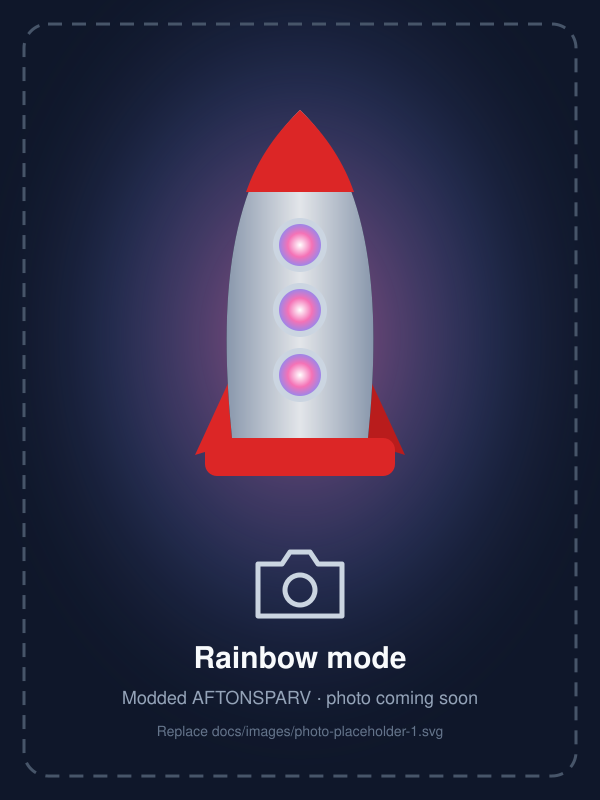
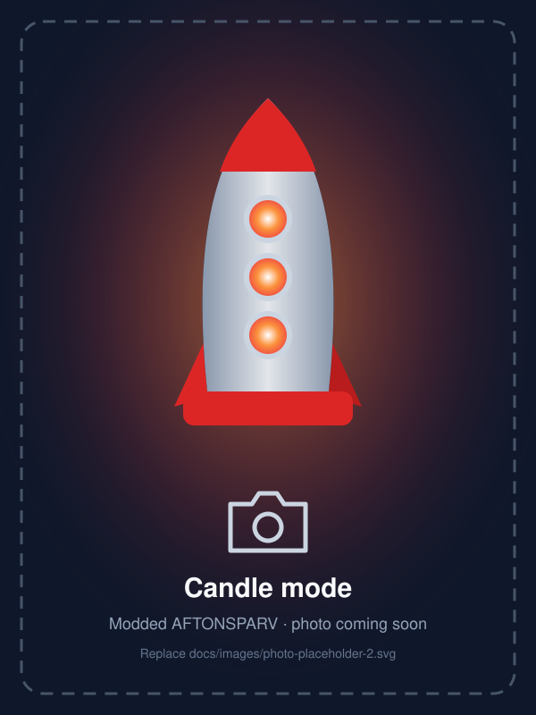
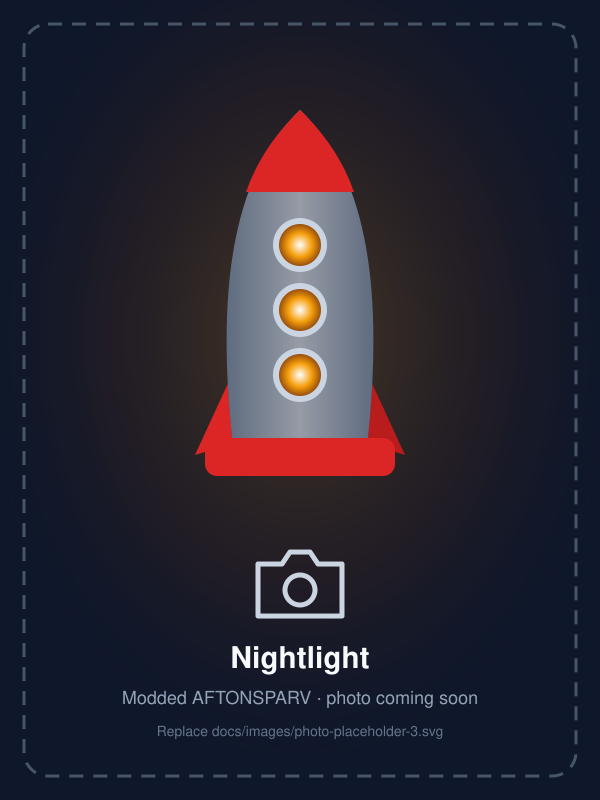
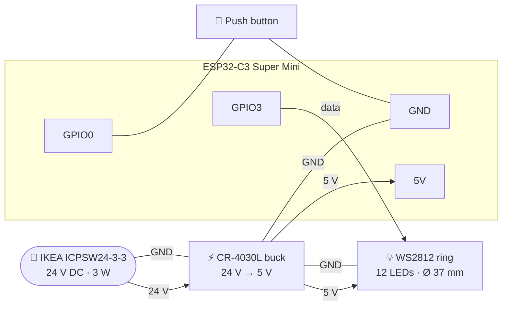
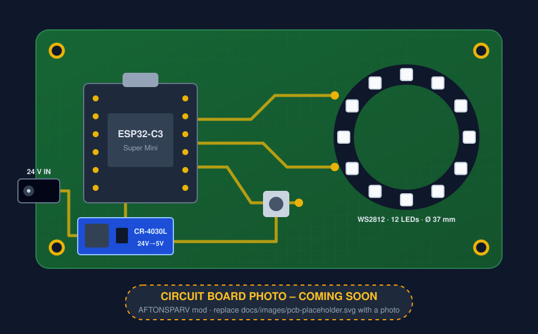
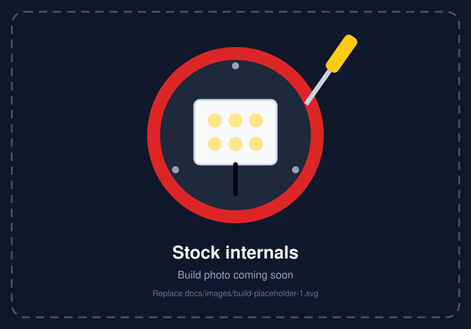
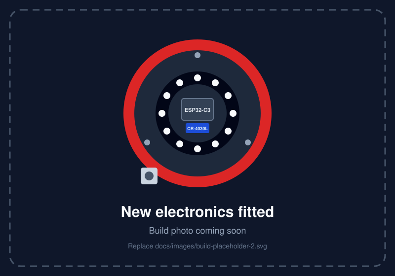

<div align="center">


<br>

[](https://www.ikea.com/gb/en/p/aftonsparv-led-table-lamp-rocket-multicolour-00555231/)
[](https://esphome.io)
[](https://www.home-assistant.io)
[](https://www.espressif.com/en/products/socs/esp32-c3)

**Give IKEA's AFTONSPARV rocket lamp a new brain.**<br>
Swap the stock electronics for an ESP32-C3 and a WS2812 LED ring, and the kids' rocket gets smooth fades,
rainbow & candle effects, a nightlight, stepless dimming and full Home Assistant control.
The firmware installs as an ESPHome package straight from GitHub.

[Features](#-features) •
[Gallery](#-gallery) •
[The mod](#-the-hardware-mod) •
[Install](#-firmware-installation) •
[Controls](#-button-controls) •
[Customise](#-customisation) •
[Troubleshooting](#-troubleshooting)

</div>

---

> [!CAUTION]
> This is an unofficial hobby project and is **not affiliated with or endorsed by IKEA**. Opening and
> modifying the lamp voids its warranty, and the modified lamp no longer carries IKEA's safety testing for
> children's products. The mod only touches the **low-voltage (24 V DC) side** – never open the plug-in
> adapter. Insulate all connections, fix everything firmly in place, and build it at your own risk.

## ✨ Features

### Stock vs. modded

| | IKEA AFTONSPARV (stock) | 🚀 Rocket Lamp (modded) |
| --- | :---: | :---: |
| Colours | 7 colours | 9 modes + any colour from Home Assistant |
| Colour cycling | Automatic colour switching | 🌈 Smooth rainbow + 🕯️ flickering candle |
| Button | Pick a colour or auto mode | Click / double / triple click + hold gestures |
| Smart home | – | 🏠 Native Home Assistant light entity |
| Updates | – | 📡 Encrypted over-the-air updates |

### Highlights

|     |     |
| --- | --- |
| 🌈 **9 lighting modes** | Rainbow, Candle, Warm White, Red, Blue, Green, Yellow, Purple and Pink |
| 🎞️ **Smooth everything** | Fades on power on/off and cross-fades between modes, no hard cuts |
| 🔘 **One-button control** | Click, double click, triple click and hold – no app needed |
| 🌙 **Nightlight & dimming** | Warm 1 % glow when held while off, stepless dimming when held while on |
| 🔌 **Keeps the IKEA adapter** | Runs from the lamp's original 24 V power supply through a tiny buck converter, with a built-in LED output cap so it never overloads |
| 🏠 **Home Assistant native** | Auto-discovered light entity with every effect and a colour picker |
| 📦 **Remote package** | Pull the firmware from GitHub, keep only Wi-Fi + key in your own YAML |
| 🔐 **Secure by default** | Encrypted API *and* encrypted OTA updates with a single key |

## 📸 Gallery

> [!NOTE]
> These are placeholders – real photos are coming soon. Drop your pictures into
> [`docs/images/`](docs/images) and update the links below.

<table>
  <tr>
    <td align="center"><br><sub><b>Rainbow mode</b></sub></td>
    <td align="center"><br><sub><b>Candle mode</b></sub></td>
    <td align="center"><br><sub><b>Nightlight</b></sub></td>
  </tr>
</table>

## 🔧 The hardware mod

The lamp's original LED board and controller come out. In their place go an **ESP32-C3 Super Mini**,
a **37 mm, 12-LED WS2812 ring** and a **new push button**. The **original IKEA adapter stays** – a
tiny **CR-4030L** buck converter in the base turns its 24 V into the 5 V the new electronics need.

### Bill of materials

| Qty | Part | Notes |
| :-: | ---- | ----- |
| 1 | **IKEA AFTONSPARV LED table lamp, rocket** | e.g. article 005.552.31 (UK) – the number varies by country |
| 1 | IKEA **ICPSW24-3-3** adapter | Comes with the lamp: 24 V DC, max 125 mA / 3 W |
| 1 | **[CR-4030L buck converter, 6–32 V → 5 V](https://www.aliexpress.com/item/1005005505907937.html)** | Tiny fixed-output step-down module – pick the **6V-32V to 5V** version, which handles the 24 V adapter with headroom. Alternatives must accept 24 V input: an MP1584EN works, a Mini-360 (~23 V max) does not |
| 1 | **ESP32-C3 Super Mini** | Any ESP32-C3 board works, see [other boards](#using-a-different-board) |
| 1 | **WS2812 LED ring, 12 LEDs** – [AliExpress](https://www.aliexpress.com/item/1005007659632831.html) or [Adafruit NeoPixel Ring 12](https://www.adafruit.com/product/1643) | **37 mm** outside / **23 mm** inside diameter – choose the *12 bits* (AliExpress) or *12 x RGB LEDs* (Adafruit) version |
| 1 | **Momentary push button** | Normally open, wired to GND |
| – | Thin silicone wire, heat-shrink, hot glue / double-sided foam tape | Keep everything insulated and fixed |

#### 🛒 Where to buy

The parts used in the original build come from AliExpress:

- **LED ring:** [WS2812 RGB LED ring, 37 mm](https://www.aliexpress.com/item/1005007659632831.html) – select the **12 bits** version
- **Buck converter:** [CR-4030L DC-DC step-down module](https://www.aliexpress.com/item/1005005505907937.html) – select the **6V-32V to 5V** version

A good alternative LED ring:

- **LED ring:** [Adafruit NeoPixel Ring – 12 x 5050 RGB LED](https://www.adafruit.com/product/1643) – same size
  (36.8 mm outside / 23.3 mm inside), ships with WS2812B or SK6812 LEDs (same protocol) and is available
  from many local distributors. Select **12 x RGB LEDs** – the RGBW and WWA variants won't work with this firmware.

> [!NOTE]
> Marketplace listings change over time. If a link is dead, search for the part name and check the
> specs above (ring size, LED count, 5 V output, 24 V-capable input).

### Power budget

The stock adapter delivers only **3 W**. After the CR-4030L (roughly 90–95 % efficient) that leaves
about **550 mA at 5 V** for the ESP32-C3 *and* the LEDs. The ESP32-C3 needs ~100–120 mA of that,
and each WS2812 colour channel can draw up to ~20 mA at full power:

| Mode (12 LEDs) | Worst case at 100 % | With the 50 % cap | + ESP32-C3 |
| -------------- | ------------------: | ----------------: | ---------: |
| ⚪ Full white (picked in Home Assistant) | ~720 mA ❌ | ~360 mA | ~480 mA ✅ |
| 🌈 Rainbow (yellow/cyan/magenta peaks) | ~480 mA ⚠️ | ~240 mA | ~360 mA ✅ |
| 🔆 Warm White | ~440 mA ⚠️ | ~220 mA | ~340 mA ✅ |
| 🟡 Solid Yellow | ~410 mA ⚠️ | ~205 mA | ~325 mA ✅ |
| 🟣 Solid Purple | ~400 mA ⚠️ | ~200 mA | ~320 mA ✅ |
| 🌸 Solid Pink | ~390 mA ⚠️ | ~195 mA | ~315 mA ✅ |
| 🕯️ Candle | ~360 mA | ~180 mA | ~300 mA ✅ |
| 🔴 🟢 🔵 Single colour | ~240 mA | ~120 mA | ~240 mA ✅ |

Uncapped, white and the brighter modes would overload the adapter, making the lamp flicker or reboot.
That's why the firmware **caps the LED output at 50 % by default** (`max_brightness_pct`). The cap is
applied to the hardware output, so **100 % in Home Assistant = the safe maximum**, and dimming, fades
and the nightlight all work across the full range. The nightlight brightness is compensated
automatically, so it looks exactly as it would without the cap.

> [!TIP]
> These are worst-case figures; real WS2812s often draw less. If you pick pure white at 100 % in
> Home Assistant and measure the current with a USB meter or multimeter, you can raise the cap as long as the LEDs stay below ~400 mA (leaving headroom for the ESP32-C3):
>
> ```yaml
> substitutions:
>   max_brightness_pct: "60"
> ```
>
> Using a bigger 5 V supply instead of the IKEA adapter? Then you can set it to `"100"`.

The firmware also lowers the Wi-Fi TX power (8.5 dB), which saves a little power as well.

### Wiring

| From | To | Substitution |
| ---- | -- | ------------ |
| IKEA adapter **+24 V** (lamp's DC input) | CR-4030L `VIN` | – |
| IKEA adapter **GND** | CR-4030L `GND` | – |
| CR-4030L `VOUT` (**check it reads 5.0 V first!**) | ESP32-C3 `5V` and LED ring `5V` / `VCC` | – |
| CR-4030L `GND` | ESP32-C3 `GND`, LED ring `GND`, one leg of the button | – |
| ESP32-C3 `GPIO3` | LED ring `DIN` | `led_pin` |
| ESP32-C3 `GPIO0` | Other leg of the button (internal pull-up is enabled) | `button_pin` |



### Circuit board

<p align="center">
  <a href="https://app.cirkitdesigner.com/project/2a295333-1f8f-4950-9f45-bd626191a41b" target="_blank">
    
  </a>
</p>

### Build steps

<table>
  <tr>
    <td align="center"><br><sub><b>Stock internals</b></sub></td>
    <td align="center"><br><sub><b>New electronics fitted</b></sub></td>
  </tr>
</table>

1. **Flash first.** Install the firmware on the ESP32-C3 over USB *before* it goes into the lamp
   (see [Firmware installation](#-firmware-installation)). Later updates happen over Wi-Fi.
2. **Unplug and open the lamp.** Unscrew the base – IKEA ships the adapter and fins inside it,
   so it's designed to come apart with a screwdriver.
3. **Remove the stock electronics.** Take out the original LED board and controller. Keep the
   lamp's DC input (socket or cable) for the IKEA adapter, because it powers the buck converter.
   Check its polarity with a multimeter before you wire anything to it.
4. **Check the buck converter.** The CR-4030L (6–32 V → 5 V version) has a fixed output, so there's
   nothing to adjust – but power it from the IKEA adapter on its own and make sure a multimeter reads
   5.0 V on the output (a wrong variant would destroy the ESP32 and LEDs). Do this **before** you
   connect anything else.
5. **Fit the LED ring** (37 mm outside, 23 mm inside diameter) where the original LED board sat,
   LEDs facing the acrylic lens.
6. **Fit the new push button** somewhere easy to reach, for example in the base.
7. **Wire it up** as shown in the [wiring table](#wiring). Insulate every joint with heat-shrink and
   fix the boards with hot glue or foam tape so nothing can rattle loose.
8. **Test before closing.** Plug in the adapter. The lamp should join Wi-Fi and react to the button.
   Then screw the base back on.

> [!IMPORTANT]
> Never connect USB to the ESP32-C3 while the lamp is powered from the IKEA adapter. On many Super Mini
> boards the `5V` pin is wired straight to USB `VBUS`, so the two supplies would fight. For USB
> flashing or logs, unplug the adapter first – or just use OTA updates.

## 🚀 Firmware installation

The firmware is published as an [ESPHome remote package](https://esphome.io/components/packages/#remotegit-packages).
Your own device config only contains what is personal to you – Wi-Fi credentials and an encryption
key – and pulls everything else from this repository.

> [!IMPORTANT]
> Requires **ESPHome 2026.9.0 or newer** (for encrypted OTA updates).

### 1. Create your device config

Create `rocket-lamp.yaml` in your ESPHome config folder (or copy [`example.yaml`](example.yaml)):

```yaml
substitutions:
  name: rocket-lamp
  friendly_name: Rocket Lamp

packages:
  rocket_lamp: github://nfjodor/ikea-rocket-lamp/rocket-lamp.yaml@main

api:
  encryption:
    key: !secret api_encryption_key

wifi:
  ssid: !secret wifi_ssid
  password: !secret wifi_password
```

### 2. Add your secrets

Add these to your `secrets.yaml` (see [`secrets.example.yaml`](secrets.example.yaml)):

```yaml
wifi_ssid: "your-wifi"
wifi_password: "your-wifi-password"
api_encryption_key: "..."   # openssl rand -base64 32
```

> [!NOTE]
> Remote packages can't read `!secret` themselves, which is why the secrets live in your device
> config. The same API key also encrypts OTA updates – there is no separate OTA password.

### 3. Flash it

<details open>
<summary><b>🏠 ESPHome Device Builder (Home Assistant add-on)</b></summary>

1. Open **ESPHome Device Builder** → **+ New device** → **Continue** → **Skip**.
2. Open the new device's YAML, replace it with the config from step 1 and **Save**.
3. Plug the ESP32-C3 into your computer via USB (not yet wired to the IKEA adapter) and choose
   **Install** → **Plug into this computer** (or **Manual download** and flash it with
   [web.esphome.io](https://web.esphome.io)).
4. Once it's built into the lamp, update over Wi-Fi with **Install** → **Wirelessly**.

</details>

<details>
<summary><b>💻 ESPHome CLI</b></summary>

```bash
pip install --upgrade esphome      # 2026.9.0 or newer
esphome run rocket-lamp.yaml       # first time over USB, afterwards over Wi-Fi
esphome logs rocket-lamp.yaml      # watch it work
```

</details>

<details>
<summary><b>📶 Lamp can't join Wi-Fi?</b></summary>

If the credentials are wrong the lamp opens a hotspot called **"Rocket Lamp Fallback"**.
Connect to it and a captive portal lets you pick the right network.

</details>

### 4. Add it to Home Assistant

Home Assistant discovers the lamp automatically: **Settings → Devices & services → ESPHome →
Configure**, then paste your `api_encryption_key`. You get a **Lamp** light entity with brightness,
colour and every effect.

## 🔘 Button controls

| Gesture | When the lamp is **off** | When the lamp is **on** |
| ------- | ------------------------ | ----------------------- |
| **Click** | Fade on with the last brightness and mode | Fade off |
| **Double click** | Turn on in the last used mode | Cross-fade to the next mode |
| **Triple click** | Reset to **Warm White @ 60 %** | Reset to **Warm White @ 60 %** |
| **Hold** (≥ 0.7 s) | 🌙 Warm nightlight at 1 % | 🔅 Dim / brighten while held – direction flips on every new hold |

**Mode cycle (double click):**
🌈 Rainbow → 🕯️ Candle → 🔆 Warm White → 🔴 Red → 🔵 Blue → 🟢 Green → 🟡 Yellow → 🟣 Purple → 🌸 Pink → 🌈 …

**From Home Assistant** you can pick any effect, brightness or colour. Picking a colour while an
effect is running stops the effect so your colour shows, and leaving the nightlight for a mode
brings back the brightness you had before.

> [!TIP]
> A rocket that glows dim red at bedtime and fades off automatically makes a great Home Assistant
> automation for the kids' room.

## 🎨 Customisation

Every value below is a [substitution](https://esphome.io/components/substitutions/) – override it
in the `substitutions:` block of your own device config, no fork required.

<details open>
<summary><b>Device & hardware</b></summary>

| Substitution | Default | Description |
| ------------ | ------- | ----------- |
| `name` | `rocket-lamp` | Hostname (`rocket-lamp.local`) |
| `friendly_name` | `Rocket Lamp` | Name shown in Home Assistant |
| `led_pin` | `GPIO3` | WS2812 data pin |
| `button_pin` | `GPIO0` | Push button pin (to GND) |
| `num_leds` | `12` | Number of LEDs in your ring |
| `led_chipset` | `WS2812` | Any [`esp32_rmt_led_strip`](https://esphome.io/components/light/esp32_rmt_led_strip/) chipset |
| `led_rgb_order` | `GRB` | Colour order of your LEDs |
| `max_brightness_pct` | `50` | LED output cap in %, keeps the 3 W IKEA adapter from overloading – see [power budget](#power-budget) |

</details>

<details>
<summary><b>Button timing</b></summary>

| Substitution | Default | Description |
| ------------ | ------- | ----------- |
| `click_max` | `400ms` | Longest press that still counts as a click |
| `click_gap` | `400ms` | Longest pause between clicks of a double/triple click |
| `long_press` | `700ms` | Hold time that starts nightlight / dimming |

</details>

<details>
<summary><b>Fades & effects</b></summary>

| Substitution | Default | Description |
| ------------ | ------- | ----------- |
| `fade_ms` | `250` | On/off fade in ms |
| `mode_fade_ms` | `250` | Cross-fade between modes in ms |
| `dim_step_ms` | `40` | Interval of the dimming loop in ms |
| `dim_factor` | `1.06` | Brightness multiplier per dimming step |
| `rainbow_speed` | `2` | Rainbow speed – one full cycle takes `65536 / speed` ms |

</details>

**Example** – a second rocket for the kids' room with a slower rainbow and snappier double clicks:

```yaml
substitutions:
  name: kids-room-rocket
  friendly_name: Kids Room Rocket
  rainbow_speed: "1"
  click_gap: 300ms
```

### Overriding components

Need more than substitutions? ESPHome merges your YAML on top of the package, and
[`!extend` / `!remove`](https://esphome.io/components/packages/#extend) let you change any
component that has an `id`:

```yaml
light:
  - id: !extend lamp_light
    name: Rocket                # rename the Home Assistant entity
    restore_mode: ALWAYS_OFF    # always start off after a power cut
```

### Using a different board

The firmware is split into small packages, so you can swap the board and keep the lamp logic:

| File | Contents |
| ---- | -------- |
| [`rocket-lamp.yaml`](rocket-lamp.yaml) | Complete firmware: naming, API, OTA, Wi-Fi + the two packages below |
| [`packages/board-esp32-c3-supermini.yaml`](packages/board-esp32-c3-supermini.yaml) | ESP32-C3 Super Mini: chip, framework, Wi-Fi tuning, default pins |
| [`packages/lamp.yaml`](packages/lamp.yaml) | The lamp itself: light, effects, button logic – board independent |

For example, if you'd rather fit a different ESP32 board into the rocket, pull only the lamp logic and
bring your own board setup:

```yaml
substitutions:
  led_pin: GPIO16
  button_pin: GPIO17

packages:
  rocket_lamp:
    url: https://github.com/nfjodor/ikea-rocket-lamp
    ref: main
    files: [packages/lamp.yaml]

esphome:
  name: rocket-lamp
  friendly_name: Rocket Lamp

esp32:
  board: esp32dev
  framework:
    type: esp-idf

logger:
api:
  encryption:
    key: !secret api_encryption_key
ota:
  - platform: esphome
    encryption:
wifi:
  ssid: !secret wifi_ssid
  password: !secret wifi_password
```

> [!WARNING]
> The light uses the `esp32_rmt_led_strip` platform, so the lamp package needs an **ESP32-family**
> chip (ESP32, -C3, -S2, -S3, -C6 …). Bigger boards also draw more power – keep the
> [power budget](#power-budget) in mind.

### Updates & version pinning

- `@main` always follows the latest version. ESPHome caches remote packages for a day – run
  `esphome clean rocket-lamp.yaml` or set `refresh: 0s` (long form below) to pull changes immediately.
- Pin a release tag for reproducible builds:

```yaml
packages:
  rocket_lamp:
    url: https://github.com/nfjodor/ikea-rocket-lamp
    ref: v1.0.0       # tag, branch or commit
    files: [rocket-lamp.yaml]
    refresh: 1d
```

## 🗂️ Repository layout

```text
rocket-lamp/
├── rocket-lamp.yaml                     # 📦 main package – point your config here
├── packages/
│   ├── board-esp32-c3-supermini.yaml    # 🧩 board: chip, Wi-Fi tuning, pins
│   └── lamp.yaml                        # 🧩 lamp: light, effects, button logic
├── example.yaml                         # 📝 device config that pulls from GitHub
├── dev.yaml                             # 🛠️ device config that builds from this checkout
├── secrets.example.yaml                 # 🔑 template for secrets.yaml
└── docs/images/                         # 🖼️ banner, board, build and product photos
```

## 🛠️ Development

Work on the firmware locally without pushing to GitHub first:

```bash
git clone https://github.com/nfjodor/ikea-rocket-lamp.git
cd rocket-lamp
cp secrets.example.yaml secrets.yaml     # fill in your values
esphome run dev.yaml                     # builds from the local files
```

[`dev.yaml`](dev.yaml) includes [`rocket-lamp.yaml`](rocket-lamp.yaml) with `!include` instead of
the GitHub URL, so every edit is picked up on the next build.

## 🩺 Troubleshooting

| Symptom | Fix |
| ------- | --- |
| Lamp flickers, goes dark or reboots at high brightness (especially white) | The 3 W IKEA adapter is overloaded. If you raised `max_brightness_pct`, lower it again – see [power budget](#power-budget). |
| Lamp isn't as bright as expected | The LED output is capped at 50 % to protect the IKEA adapter. Raise `max_brightness_pct` only after measuring the current, or with a stronger 5 V supply. |
| Nothing lights up after the mod | Check the buck output is really 5.0 V, the LED data wire goes to the ring's `DIN` (not `DOUT`), and all grounds are connected. |
| Buck converter gets hot | Check the output really is 5.0 V and nothing is shorted. If you used a different module, make sure its input is rated for 24 V. The LEDs may also be drawing too much (see above). |
| Wi-Fi drops or Home Assistant shows the lamp as unavailable | The Super Mini antenna is weak, and inside the rocket it sits close to LEDs and wiring. Route the antenna end away from them. Raise `wifi: output_power` only if the power budget allows. |
| `the device did not offer encryption` during OTA | The lamp runs firmware without OTA encryption. Flash once over USB, or see [enabling encryption on an existing device](https://esphome.io/components/ota/esphome/#enabling-encryption-on-an-existing-device). |
| `Secret ... not defined` | Add the missing key to the `secrets.yaml` next to your device config. |
| Colours are swapped (red shows green) | Set `led_rgb_order` to match your LEDs, e.g. `RGB`. |
| Only some LEDs light up | Set `num_leds` to the actual number of LEDs on your ring. |
| Nightlight is completely dark | Some LEDs can't show 1 %, which is why `gamma_correct` is `1.0` and the nightlight brightness is compensated for `max_brightness_pct`. Check the LED supply and ground connections. |
| Package changes don't show up | Remote packages are cached – run `esphome clean <config>.yaml` or use `refresh: 0s`. |

---

<div align="center">

Made with ❤️, ☕ and a lot of blinking LEDs · Powered by [ESPHome](https://esphome.io) &amp; [Home Assistant](https://www.home-assistant.io)

<sub>IKEA and AFTONSPARV are trademarks of Inter IKEA Systems B.V. This project is not affiliated with IKEA.</sub>

</div>
